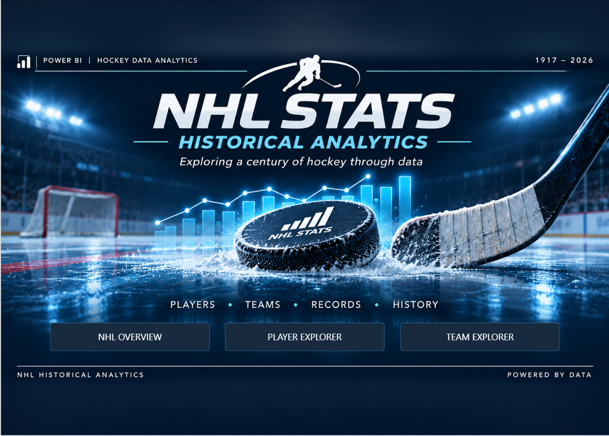
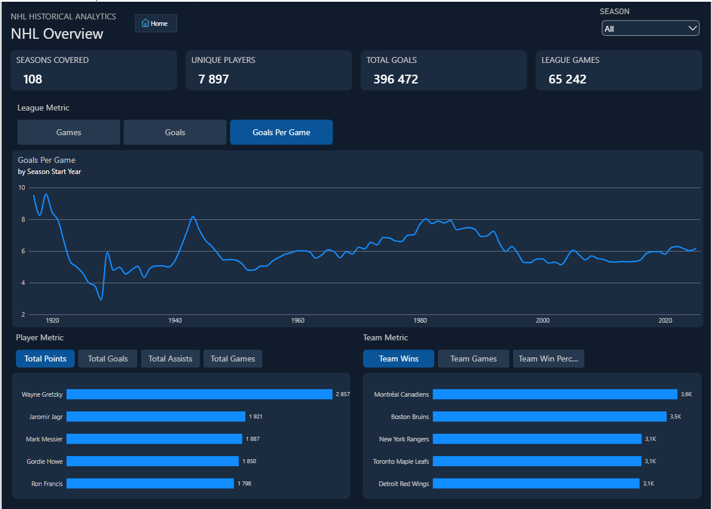
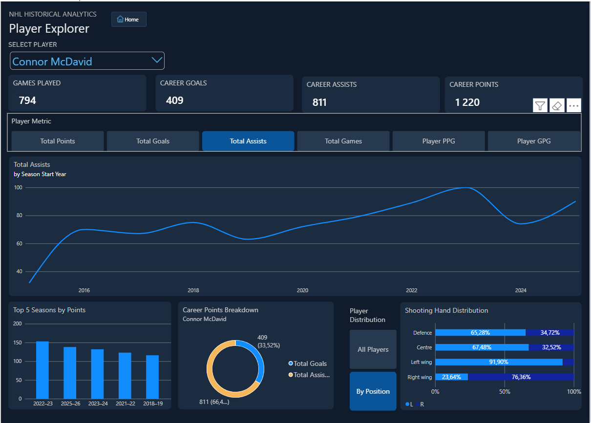
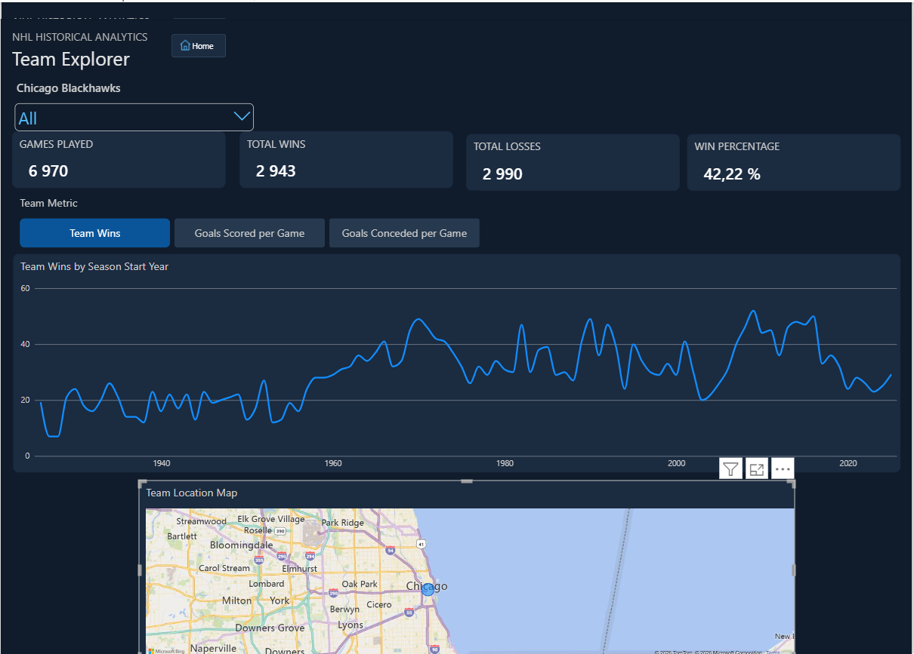

[English](README.md) | [Čeština](README.cs.md)

# 🏒 NHL Historical Analytics

**Power BI project – Data Analysis and Visualization**  
**Author:** Zdeněk Matuščin  
**Tools:** Power BI Desktop, Power Query, DAX, GitHub

## 1. About the project

This is my second project for the Data Academy. I built an interactive Power BI report about the history of the **National Hockey League (NHL)**.

The goal was to turn historical hockey data into clear charts. Users can explore seasons, players and teams. They can also change some statistics with buttons and move between report pages.

The current report uses historical regular-season data, starting in **1917–18** and continuing through **2025–26**.

## 2. Data sources

I worked with historical NHL data provided in CSV files:

- `aidb-nhl-skater-seasons-1917-1979.csv` – player season statistics for the early years.
- `aidb-nhl-skater-seasons-1979-2005.csv` – player season statistics for later years.
- `aidb-nhl-skater-seasons-2005-present.csv` – more recent player season statistics.
- `aidb-nhl-season-standings.csv` – team results by season.
- `nhl_teams.json` – team names and IDs, including historical teams.
- A separate team-location lookup – cities, countries, latitude and longitude for the map.

I cleaned and prepared the data in **Power Query**. I used one data model with dimension tables and fact tables, so the filters and charts work together.

The report is a historical data snapshot. It is **not a live NHL dashboard**.

## 3. Report pages

### Home

The cover page introduces the project. It has navigation buttons for the three analysis pages.

### NHL Overview

This page shows the bigger picture of NHL history:

- Number of seasons and players, total goals and league games.
- A line chart of goals by season.
- Top 5 players and Top 5 teams.
- A season filter and buttons to change ranking statistics.

### Player Explorer

Users can choose a player and see:

- Career games, goals, assists and points.
- Points by season and Top 5 seasons.
- Goals versus assists in a donut chart.
- The share of left- and right-shooting players, for all players or by position.

### Team Explorer

Users can choose a team and see:

- Games, wins, losses and win percentage.
- Team performance by season.
- Buttons to change between wins, goals scored per game and goals conceded per game.
- A map with the team's location.

### Examples from the report

- **Wayne Gretzky:** 2,857 career points in the regular season. His best season was **1985–86** with **215 points**.
- A high number of wins does not always mean a higher win percentage. The number of games in a season also matters.
- Player goals and assists are parts of total points. A donut chart shows this share for the selected player.

## 4. Data model and Power BI methods

The main model has these tables:

| Table | Purpose |
| --- | --- |
| `DimPlayer` | Player names and IDs |
| `DimTeam` | Team names, IDs and locations |
| `DimSeason` | Seasons and start years |
| `FactPlayerStats` | Player statistics by season |
| `FactTeamStats` | Team statistics by season |

The dimension tables have **one-to-many relationships** with the fact tables. Filters normally move from a dimension to a fact table.

In this project, I used:

- **Power Query:** cleaning data, changing data types and joining tables.
- **DAX measures:** `SUM`, `DISTINCTCOUNT`, `DIVIDE` and `SELECTEDVALUE`.
- **Field Parameters:** changing the statistics shown in one chart.
- **`SWITCH`:** changing the value used for dynamic Top 5 rankings.
- **Slicers and visual interactions:** filtering the report.
- **Page navigation:** moving between pages with buttons.
- **Different visuals:** cards, line charts, bar and column charts, donut charts, a 100% stacked bar chart and a map.

Example DAX measures:

```dax
Total Goals = SUM(FactPlayerStats[goals])

Active Players = DISTINCTCOUNT(FactPlayerStats[player_id])

Team Win Percentage = DIVIDE([Team Wins], [Team Games])
```

## 5. Project structure

The GitHub repository has this structure:

```text
nhl-historical-analytics-powerbi/
├── README.md
├── README.cs.md
├── NHL_Historical_Analytics.pbix
└── screenshots/
    ├── 01-home.png
    ├── 02-nhl-overview.png
    ├── 03-player-explorer.png
    └── 04-team-explorer.png
```

The `.pbix` file contains the Power BI report and its data model. The screenshots let visitors see the pages without opening Power BI.

### Report preview

The four pages of the Power BI report are shown below. Click a screenshot to see the full image.

| Home | NHL Overview |
| --- | --- |
| [](screenshots/01-home.png) | [](screenshots/02-nhl-overview.png) |
| Player Explorer | Team Explorer |
| [](screenshots/03-player-explorer.png) | [](screenshots/04-team-explorer.png) |

## 6. How to open the project

1. Download `NHL_Historical_Analytics.pbix` from this repository.
2. Open it in **Power BI Desktop** on Windows.
3. Start on the **Home** page and use the navigation buttons.
4. Choose a season, player or team. Try the metric buttons to change the charts.

You can explore the saved report without the original CSV files. To **refresh the data**, you may need to update the file paths in Power Query and have access to the original sources.

## 7. Methods and limitations

It is important to understand these points when reading the charts:

- The report uses **regular-season** statistics. Playoff results are not part of this version.
- The player dataset contains **skaters, not goalies**.
- The number of teams and games changed during NHL history. Total goals and wins are not always fair comparisons between different eras.
- **Win Percentage** means wins divided by games played. It is not the percentage of league standings points.
- Some historical teams changed names or cities. The report keeps historical team names; the map shows approximate city locations, not exact arena positions.
- Some player information is missing in older seasons. In particular, shooting-hand data is not available in the earliest player source file. The shooting-hand chart uses records with known `L` or `R` values.
- The shooting-hand chart counts **unique players in each group**. A player listed at more than one position may appear in more than one position group.
- The numbers depend on the supplied data snapshot and on the cleaning rules used in this project.

## 8. Conclusion

This project helped me practise the full Power BI workflow: preparing data, building relationships, writing DAX measures and designing interactive reports.

I learned that a good dashboard needs more than charts. It needs a clear data model, useful filters, simple navigation and correct explanations of the numbers.

The result is an NHL report that readers can explore on their own.
